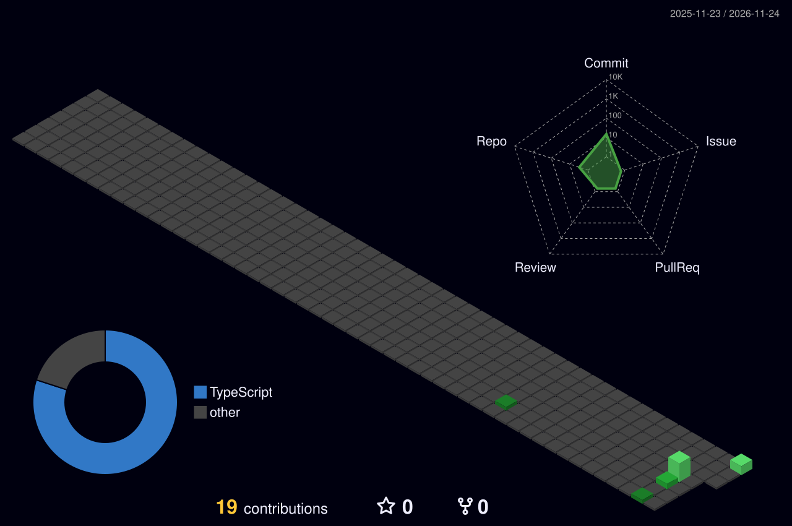

# Hi, I'm YASIN-KIK 👋

### Cybersecurity Enthusiast | Ethical Hacking | Learning Linux

Welcome to my GitHub profile!

I enjoy learning about cybersecurity, Linux, networking, Python, and open-source projects.

---

## 🛠️ Technologies & Tools

---

## 📊 GitHub Statistics

---

## 🏙️ 3D Contribution Activity

## 🐍 Contribution Snake

---

**Learning every day. Building step by step.**

